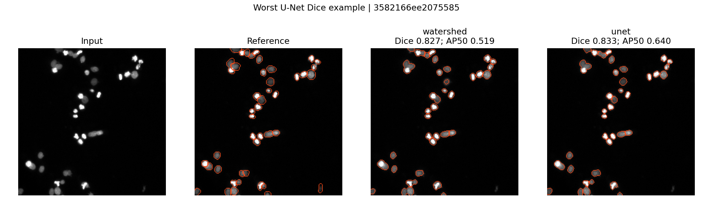
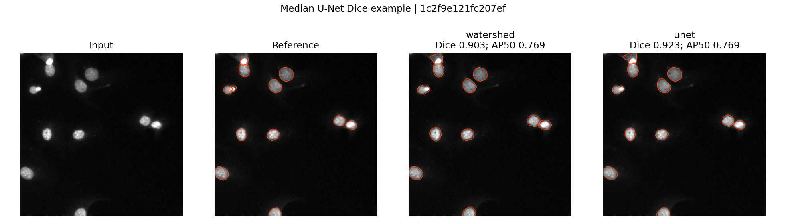
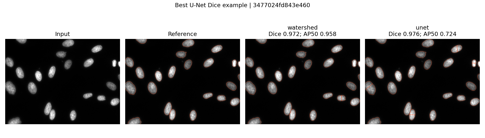

# Cell image segmentation

## Question

Can cells be segmented reliably in a public microscopy image set?
This experiment addresses **nuclei**, using public fluorescence images and
reference instance masks. On this held-out subset, both methods exceed the
prespecified foreground Dice target. Instance separation remains imperfect,
and the experiment does not establish reliability on other microscopy data.

## Approach

The public [DSB2018 archive distributed by StarDist](https://github.com/stardist/stardist/releases/tag/0.1.0)
provides paired microscopy images and instance masks from
[BBBC038v1](https://bbbc.broadinstitute.org/BBBC038). The original annotations
were produced by the Broad Imaging Platform. BBBC038 is CC0; please cite
[Caicedo et al., Nature Methods (2019)](https://doi.org/10.1038/s41592-019-0612-7)
when using this dataset. Software is licensed separately under [MIT](LICENSE).

The [scope and acceptance criteria](docs/SCOPE.md) were written before the
experiment. We select 44 image/mask pairs from a checksum-pinned
26,975,232-byte archive: lexicographically first training-partition images
are assigned to 24 train and 8 validation images; first
12 test-partition images form the held-out test set. All
44 image hashes and 44 mask hashes are unique in the selected
set. IDs, split membership and hashes are in [the manifest](results/data_manifest.json).
No test image is used for training, checkpoint selection or threshold selection.

- **Classical baseline:** percentile normalization, Gaussian smoothing, Otsu
  thresholding, hole filling, removal of small objects and distance watershed.
- **Small model:** a randomly initialized U-Net-style binary foreground network
  with 29,617 parameters, trained on CPU for 40 epochs.
  Inputs are resized to a fixed grid; output probabilities are resized back
  before thresholding and the same watershed postprocessing.
- **Selection:** checkpoint and thresholds use validation Dice only. The selected
  checkpoint is epoch 38; Otsu multiplier is 0.8
  and model threshold is 0.5. The training seed is 25.

See [the evaluation protocol](docs/METRICS.md) for architecture usage, training,
matching, threshold grids, postprocessing and empty-mask conventions.

## Results

Scores are macro averages over **12 held-out images containing
392 reference nuclei**, evaluated at native resolution.

| Method | Foreground IoU | Foreground Dice | Instance AP50 | Instance AP50:95 |
| --- | ---: | ---: | ---: | ---: |
| Otsu + watershed | 0.8184 | 0.8986 | 0.8009 | 0.5150 |
| Tiny U-Net + watershed | 0.8474 | 0.9156 | 0.7836 | 0.5475 |

**AP here is the DSB-style score TP/(TP+FP+FN)** after one-to-one instance
matching, averaged over IoU thresholds for AP50:95. It is not COCO AP or a
confidence-ranked precision–recall integral. IoU and Dice score binary
foreground; AP scores separate nuclei.

The U-Net improves mean foreground Dice and mean AP50:95, but its AP50 is lower
than the classical baseline. Better pixel overlap does not imply consistently
better instance separation. Its per-image Dice ranges from 0.8332 to
0.9756; detailed scores are in [per_image.csv](results/per_image.csv).

The Dice acceptance target of 0.70 is **met**. Artifact verification found
24/24 prediction masks,
24/24 evaluation rows and
3/3 overlays. All 24 masks
exactly matched regenerated inference; metrics were recomputed from saved masks.
The morphology/QC table contains 1,122 object rows across reference
and predicted masks, with area, perimeter, eccentricity, centroid and a
border-touching flag. All measurements are in pixels.

On the recorded CPU run (4 PyTorch threads), training took
48.82 seconds and the full benchmark took 52.17 seconds.
Peak process RSS was 678.06 MiB. These are measurements from this
host, not a hardware-independent runtime guarantee. Package versions and host
information are recorded in [summary.json](results/summary.json).

The local pytest suite passed **13/13 tests**, with
0 failures/errors. Tests cover overlap arithmetic,
merges/splits, empty masks, noncontiguous labels, input validation, border
objects, and training → checkpoint reload → native-size inference → TIFF readback.
[GitHub Actions](https://github.com/Akkaya-Furkan/cell-image-segmentation/actions/workflows/ci.yml) runs this suite on pushes and pull requests.

### Visual quality control

Orange contours show instance boundaries. These are the worst, upper-middle
and best examples ranked by U-Net Dice; all test images have numeric scores.





## Reproduce

```bash
~/miniconda3/bin/conda env create -f environment.yml
source ~/miniconda3/etc/profile.d/conda.sh
conda activate p25-cellseg
python scripts/download_data.py
pytest -q --junitxml=results/local-tests.xml
python -m cellseg.benchmark
python scripts/verify_results.py
```

The download needs no account. It verifies the pinned SHA-256 and extracts only
the selected image/mask pairs. `data/` and raw archives are excluded from Git.
Rerunning with the pinned environment and seed regenerates the experiment;
small floating-point differences on other hardware/library builds are possible.
The output directory should be fresh when changing the experiment.

Apply the delivered checkpoint without retraining:

```bash
python -m cellseg.predict path/to/image.tif path/to/prediction.tif
```

Committed artifacts include [the checkpoint](results/tiny_unet.pt),
[instance masks](results/masks/), [morphology features](results/features.csv),
[training history](results/training_history.csv),
[validation-only selection](results/validation_selection.csv), and
[artifact verification with SHA-256 hashes](results/verification.json).
Raw data must be downloaded to rerun verification.

## Limitations

- Whole-cell membrane/cytoplasm segmentation: **not done**. Labels are nuclei.
- Full-dataset evaluation, repeated random seeds, statistical significance tests,
  confidence intervals and external-laboratory validation: **not done**. The
  small, deterministic lexical subset is not a representative population sample.
  Hash disjointness does not establish donor or acquisition-batch independence.
- Large-scale training and pretrained Cellpose/StarDist comparison: **not done**.
  The model is trained from scratch on a small subset. Training and validation
  images share a public source, and annotation imperfections can affect scores.
- GPU/AMD acceleration and GPU-memory benchmarking: **not done**. CPU only was
  exercised. Peak RSS describes process memory, not total machine memory.
- Clinical validation and biological feature interpretation: **not done**.
  Pixel spacing is unavailable; physical-unit morphology is not reported.
- Automated full-data download/training in CI: **not done**. CI uses synthetic
  fixtures; the real-data benchmark and artifact replay were run locally.
- Learned instance boundaries: **not done**. The U-Net learns binary foreground;
  fixed pixel-scale watershed seeds can merge touching nuclei or split large
  objects. Resizing model inputs can discard fine details. High Dice alone is
  insufficient evidence of correct object counts.
